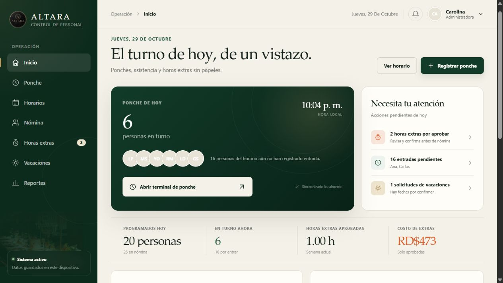

# Altara · Control de personal

Sistema web para reemplazar el control de ponches, turnos, horas extras y vacaciones que el restaurante Altara administraba en papel.



## Funcionalidades

- Terminal de entrada y salida para aproximadamente 25 empleados.
- Estado del equipo en tiempo real y control de entradas pendientes.
- Horarios semanales, días libres, permisos y rotaciones por grupos.
- Nómina con tarifas por hora, horas regulares, extras y total estimado.
- Bitácora de horas extras con flujo de aprobación.
- Balances y solicitudes de vacaciones.
- Reportes de asistencia, puntualidad y horas trabajadas.
- Exportación a CSV.
- Ajustes de jornada, pausas, redondeo y factor de horas extras.
- Persistencia local y diseño adaptable para computadora y móvil.

## Desarrollo

Requisitos:

- Node.js 20 o superior.
- pnpm.

```bash
pnpm install
pnpm dev
```

Para compilar y previsualizar la versión de producción:

```bash
pnpm build
pnpm preview
```

## Estructura

```text
src/
  components/   Componentes reutilizables de interfaz
  data/         Datos iniciales y catálogos
  lib/          Utilidades de fechas y cálculo de horas
  pages/        Módulos funcionales de la aplicación
  App.jsx       Navegación y estado principal
  styles.css    Sistema visual y diseño adaptable
public/assets/  Recursos de la marca
```

## Alcance actual

Esta versión es un prototipo funcional que guarda los datos en `localStorage`. Para producción multiusuario se debe agregar autenticación, permisos por rol y una base de datos central.

Las reglas de nómina, horas extras y vacaciones incluidas son configurables y deben validarse contra la política interna del restaurante y la legislación laboral aplicable.
